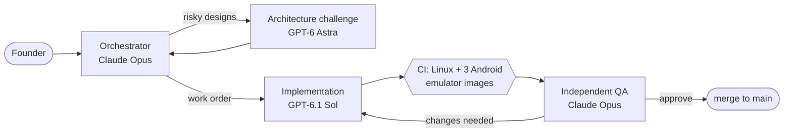

<!-- SPDX-License-Identifier: MIT. ES-DE-Plus front page; the upstream ES-DE README stays untouched at the repository root. -->

  

  
  
  
  
  

<b>Your whole game library, one beautiful controller-friendly front end — on Android, open source, top to bottom.</b>

---

## ✨ What is ES-DE Plus?

[ES-DE](https://es-de.org) (EmulationStation Desktop Edition) is a much-loved front end for browsing and launching games from your multi-platform collection. Its C++ core is open source, but its Android app is a closed, paid product.

**ES-DE Plus is an independent fork that builds the missing piece in the open:** a clean-room, fully open-source Android app around the ES-DE core, under its own name and identity — and then adds the features upstream won't take.

<table>
  <tr>
    <td width="33%" valign="top">
      <h3>📱 Truly open Android</h3>
      A new Android host and native bridge written from public documentation and the open C++ call sites — nothing copied from the proprietary app.
    </td>
    <td width="33%" valign="top">
      <h3>🔎 Search every system</h3>
      Type once and find a game across your entire collection, with a controller-friendly on-screen keyboard. Press <kbd>A</kbd> to play.
    </td>
    <td width="33%" valign="top">
      <h3>🎮 Launch into your emulators</h3>
      Finds the emulators you have installed and hands each game over the way its emulator expects — file path, storage link or a temporary read-only share.
    </td>
  </tr>
  <tr>
    <td width="33%" valign="top">
      <h3>📺 Phone, TV or home screen</h3>
      Runs as a normal app, as your Android TV app, or as your device's home screen — one instance, whichever way you enter.
    </td>
    <td width="33%" valign="top">
      <h3>🗂️ Your storage, your choice</h3>
      A first-run setup lets you keep games in the app's own folder or, explicitly, in a shared folder you pick — with real access checks, never silent fallbacks.
    </td>
    <td width="33%" valign="top">
      <h3>📖 Game manuals</h3>
      PDF manuals open right in the front end, drawn by Android's own built-in renderer.
    </td>
  </tr>
</table>

   
  Global search running on an Android TV emulator in our automated test suite (the "smoke" games are test fixtures).

## 🗺️ Where we are

| | Milestone | |
|:-:|---|---|
| ✅ | **Android build pipeline** — the open C++ frontend, the native bridge and all dependencies built from pinned, checksum-verified sources in CI, for `arm64-v8a` and `x86_64` | |
| ✅ | **First-run setup** — storage choice, permissions, phone / TV / home-screen entry points | |
| ✅ | **Game launching** — emulator discovery, Intent launching, Android-app importer, optional RetroArch core check | |
| ✅ | **PDF manuals** through Android's built-in renderer | |
| 🚧 | **Downloadable test APKs** from every green build on `main`, each with a matching source bundle | in progress |
| 🧭 | **[ES-DE Companion](https://github.com/RobZombie9043/es-de-companion) features** — second-screen artwork, app drawer, per-game display targeting and more | [planned (#3)](https://github.com/sayenah/ES-DE-Plus/issues/3) |
| 🧭 | **Signed releases** | planned |

Every Android change is built and tested on three emulator images — **Android 10**, **Android 14** and **Android TV** — driving the real screens, before it can merge.

## 📦 Get it

**Android.** Test builds are about to start appearing: once publishing lands, every successful build of `main` will offer an installable debug APK under **[Actions](https://github.com/sayenah/ES-DE-Plus/actions/workflows/build-android.yml) → a green run → Artifacts**, next to a bundle of the exact source it was built from. Test builds are signed with a throwaway key per build, so installing a newer one means uninstalling the old one first — back up first, because uninstalling deletes the app's own data.

**Desktop.** ES-DE Plus keeps upstream's Linux, macOS and Windows builds (with global search added). Build from source with [INSTALL.md](/INSTALL.md); Linux is built on every change in CI.

## 🤖 How it's built

ES-DE Plus is built AI-first, in the open, under a written [build protocol](/docs/protocol.md). Every decision is recorded in the [decision log](/docs/decision-log.md) and every finished piece in the [build log](/docs/build-log.md).

No role reviews its own work: designs are challenged before code is written, and code is reviewed by a separate QA pass before it merges.

## ⚖️ Clean room and licensing

- **Clean room.** Nothing in this repository comes from the proprietary ES-DE Android app or from decompiling it; its observable behaviour is documented in [`docs/ANDROID-CLEAN-ROOM.md`](/docs/ANDROID-CLEAN-ROOM.md) and everything is implemented from public sources. No payment or licence check is bypassed.
- **Source.** ES-DE Plus's own source is **MIT**, like upstream ES-DE.
- **Android app.** The APK contains no GPL code except libgit2, which carries a linking exception; it includes LGPL-2.1 libraries (FFmpeg built without GPL parts, libiconv, libintl, and LibRaw inside FreeImage) plus permissive, Apache-2.0, FreeImage (FIPL) and CImg (CeCILL-C) components. The full inventory is in [`android/DEPENDENCY-LICENSES.md`](/android/DEPENDENCY-LICENSES.md).
- **Identity.** ES-DE Plus uses its own application ID (`org.esdeplus.frontend`), name and icon, and is **not affiliated with or endorsed by the ES-DE project**. If you want the official ES-DE for Android, please support its developer via [es-de.org](https://es-de.org).

## 💜 Thanks

ES-DE Plus stands on the shoulders of [ES-DE](https://gitlab.com/es-de/emulationstation-de) by Leon Styhre and its contributors, [SDL](https://www.libsdl.org), and everyone listed in [CREDITS.md](/CREDITS.md). Upstream's own README — with its full feature tour — is kept unchanged at [`README.md`](/README.md).

## 📚 Learn more

| For | Read |
|---|---|
| Using the front end | [User guide](/USERGUIDE.md) · [FAQ](/FAQ.md) |
| The Android app | [`android/README.md`](/android/README.md) · [clean-room design](/docs/ANDROID-CLEAN-ROOM.md) |
| Building from source | [INSTALL.md](/INSTALL.md) |
| Themes | [THEMES.md](/THEMES.md) |
| How the project runs | [Protocol](/docs/protocol.md) · [Decision log](/docs/decision-log.md) · [Current handoff](/docs/handoff.md) |
